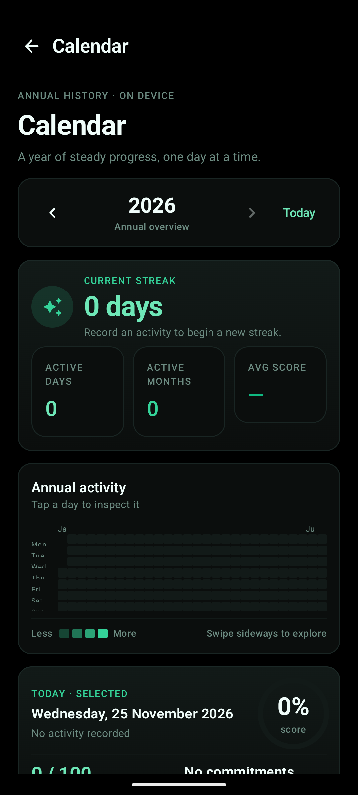
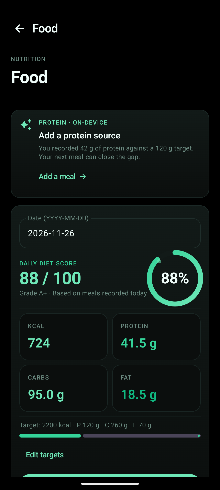
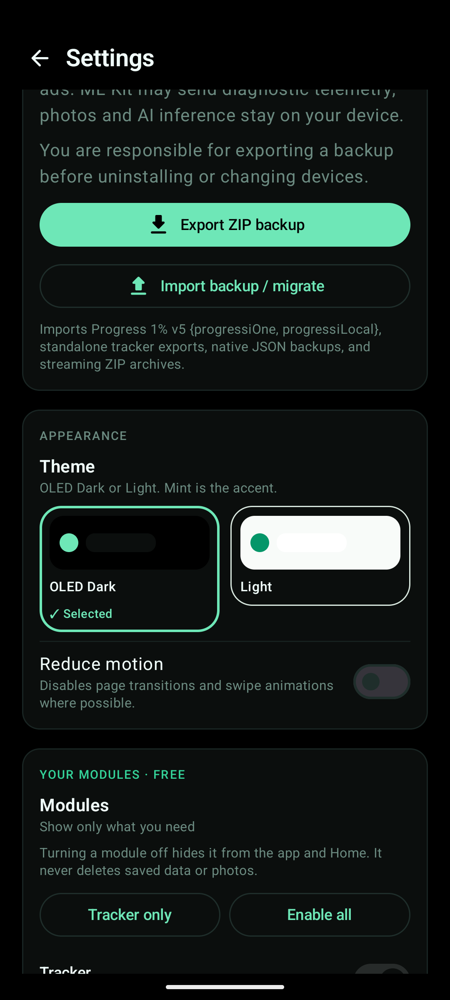

# Progress 1 Percent

[](https://github.com/borghifrancesco11-cell/progress-1-percent/releases)
[](https://kotlinlang.org/)
[](https://developer.android.com/jetpack/compose)
[](https://m3.material.io/)
[](https://developer.android.com/)
[](#privacy--data)

**Progress 1 Percent** is an *offline-first* Android personal growth app.
It brings together nutrition, training, sleep, finance, study, habits, wardrobe, and social detox into a single daily progress score.

No account is required, no cloud AI service is used, and all personal data stays in private on-device storage.

---

## Screenshots

| Home | Calendar & Streak | Food AI |
| :---: | :---: | :---: |
|  |  |  |

| Gym & Recovery | Sleep | Tracker |
| :---: | :---: | :---: |
|  |  |  |

| Tasks | Challenges | Backup ZIP |
| :---: | :---: | :---: |
|  |  |  |

---

## Key Features

- **Minimal Home**: Daily score counter (`TODAY'S SCORE`, `GOALS`, `TASKS`, `STREAK`) paired with a 4-menu horizontal slide bar (`Body`, `Recovery`, `Mind`, `Life`), each containing 2 logically grouped modules.
- **Food & Nutrition**: On-device dish recognition (**Swin Transformer Food-101**) + local neural macro estimation (`macro_estimator.onnx`), barcode lookup, portions, and daily targets.
- **Gym & Training**: Personalized workout templates recommended from your weight, height, and BMI, with sets, reps, rest timers, and personal records.
- **Sleep & Recovery**: Sleep duration, quality, recovery score, and weekly trends.
- **Tasks & School**: Daily to-dos with local Android reminders, subjects, weighted grade average, and grade simulator.
- **Finance, Challenges, Wardrobe & Detox**: Offline expense/budget tracking, personal challenges, weather-aware outfit planner, and local app-usage detox.
- **Backup & Restore**: Streamable ZIP backup with manifest checksums and atomic import.

---

## On-Device AI & Coach

All intelligence runs locally on your phone with zero API keys or cloud uploads:

| # | Component | Runtime | Purpose |
|---|-----------|---------|---------|
| 1 | **Swin Transformer Food-101** | ONNX Runtime (on-device) | Classifies dishes across 101 Food-101 categories |
| 2 | **Macro Estimator MLP** | ONNX Runtime (on-device) | Estimates calories, protein, carbs, fat, and portion size |
| 3 | **Local Coach Engine** | Deterministic Kotlin (`ProgressIntelligence`) | Generates contextual on-device guidance in Food, Gym, and Calendar |

---

## Privacy & Data

- Everything is stored locally on the device (`SQLite` + private app files).
- No account, no ads, no cloud AI.
- Open-Meteo weather lookup and Open Food Facts barcode lookup are strictly optional and on-demand.

---

## Build

Requires **JDK 21** and Android SDK (compileSdk 36, minSdk 26):

```bash
./gradlew testDebugUnitTest lintDebug assembleDebug --no-daemon
```
