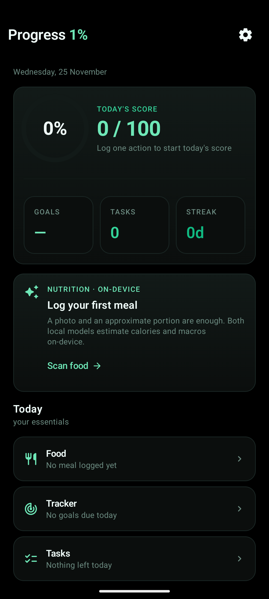
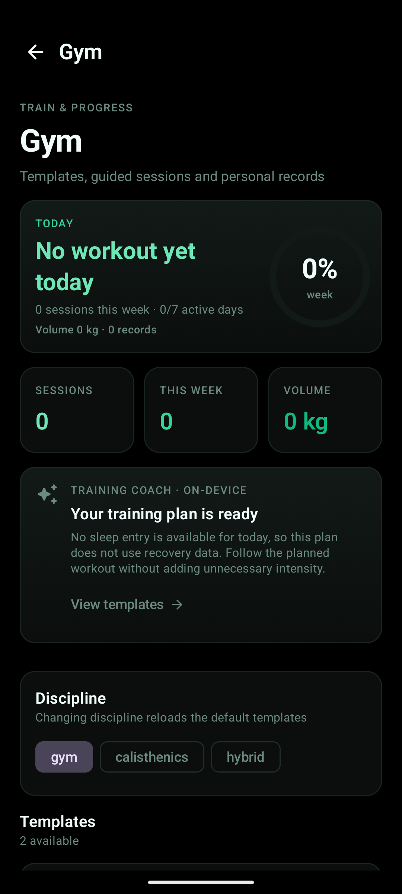
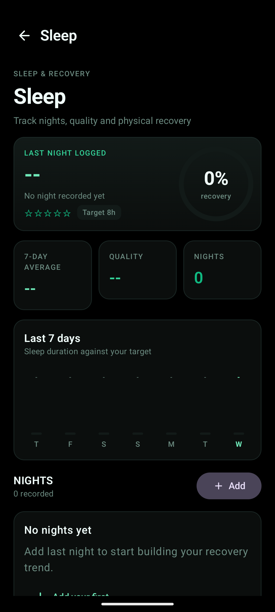
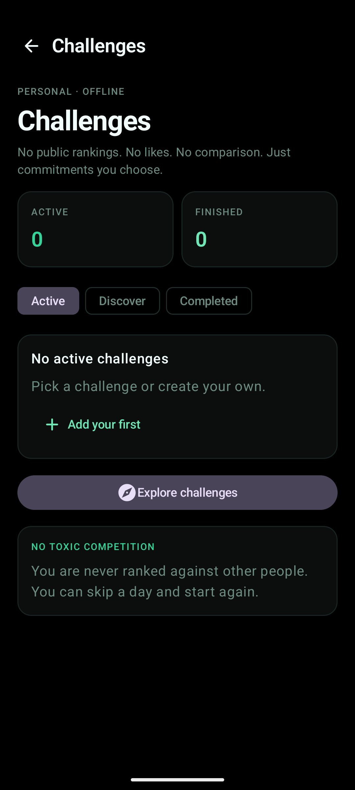

# Progress 1 Percent

[](https://github.com/borghifrancesco11-cell/progress-1-percent/releases)
[](https://kotlinlang.org/)
[](https://developer.android.com/jetpack/compose)
[](https://m3.material.io/)
[](https://developer.android.com/)
[](#privacy-e-dati)

**Progress 1 Percent** è un'applicazione Android *offline-first* per la crescita personale.
Riunisce alimentazione, allenamento, sonno, finanze, studio, abitudini, guardaroba e vita
sociale in un unico punteggio di progresso giornaliero.

L'app non richiede un account, non usa servizi AI cloud e conserva i dati personali nello
spazio privato del dispositivo. La pipeline di release costruisce e verifica la variante
production `com.progressone.nativeapp`, firma l'APK con una chiave ricevuta come secret
GitHub e pubblica APK, checksum e provenienza senza sovrascrivere release esistenti.

> **Versione e rilascio:** la fonte di verità per `versionName` e `versionCode` è
> `app/build.gradle.kts`. Il ramo `release/v1.4.0` dichiara `1.4.0` / `1400`; la
> pipeline rifiuta un tag `v*` incompatibile con `versionName`, così nome app,
> checksum e provenienza restano coerenti.
>
> **Stato verifiche al 25 novembre 2026:** nel checkout corrente sono passati i
> controlli locali della suite JVM/lint/build, i 4 test su emulatore Android 36,
> i checksum dei due modelli e i gate 16 KiB per APK e AAB. GitHub non mostrava
> ancora un tag o una Release `v1.4.0`: firma production, checksum dell'APK
> pubblicata, attestazione e pubblicazione devono quindi essere completati dalla
> CI dopo merge e push del tag. Lo stato dettagliato è in
> [docs/RELEASE.md](docs/RELEASE.md#stato-delle-verifiche-al-25-novembre-2026).

---

## Screenshot

| Home & Coach | Calendario & Streak | Food AI |
| :---: | :---: | :---: |
|  |  |  |

| Gym & Recupero | Sonno | Tracker & Impegni |
| :---: | :---: | :---: |
|  |  |  |

| Tasks | Challenges | Backup ZIP |
| :---: | :---: | :---: |
|  |  |  |

---

## Funzionalità in evidenza

### Alimentazione

- riconoscimento del piatto da foto con **Swin Transformer Food-101**, interamente sul
  dispositivo;
- stima di calorie e macronutrienti con una rete neurale locale;
- gestione di porzioni, obiettivi giornalieri e punteggio nutrizionale;
- marcatori `VISION AI` e `MACRO AI` per distinguere l'origine dei valori registrati;
- tabella nutrizionale locale e inserimento manuale sempre disponibile;
- scansione del codice a barre con dati Open Food Facts, su richiesta.

### Salute, studio e finanze

- allenamenti, serie, ripetizioni, peso, altezza, BMI e composizione corporea;
- ore di sonno, qualità del riposo e contributo al punteggio giornaliero;
- materie, voti, media ponderata e simulatore di voto;
- entrate, uscite, budget mensile e risparmio;
- tracker giornaliero, settimanale, mensile e annuale, con serie e promemoria locali.

### Organizzazione e benessere

- calendario annuale compatto con heatmap, selezione del giorno, attività e streak;
- Coach interamente locale per Home, Food e Gym, con sonno e recupero;
- task/impegni con data reale di completamento e promemoria Android locali;
- guardaroba con foto, mix & match e suggerimenti basati sul meteo; la previsione
  locale viene riutilizzata per 60 minuti solo per la città selezionata e quando
  le coordinate cache sono le stesse;
- sfide, diario, attività e controllo del tempo sulle app social;
- punteggio giornaliero pesato da 0 a 100, calcolato solo sui moduli attivi con dati;
- interfaccia in Jetpack Compose, attualmente in inglese, con tema OLED e tema chiaro;
- backup ZIP streamabile con checksum, sole foto referenziate e import atomico;
  l'export acquisisce dati e foto sotto un lock media process-wide e usa uno
  snapshot logicamente immutabile, così il checksum del manifest descrive sempre i
  byte effettivamente inseriti nel ZIP;
- primo avvio con tutorial e configurazione iniziale.

---

## Due modelli AI, completamente locali

L'app include due reti ONNX diverse. Entrambe funzionano sul telefono, senza chiave API,
senza account e senza inviare foto o dati personali a un servizio di intelligenza
artificiale.

| # | Modello | Esecuzione | Funzione | Dimensione |
|---|---------|------------|----------|------------|
| 1 | **Swin Transformer Food-101** (ONNX Runtime) | sul dispositivo, offline | classifica il piatto in 101 categorie Food-101 | 352.389.545 byte (~336 MiB) |
| 2 | **Macro estimator** — MLP con 3 livelli hidden (ONNX Runtime) | sul dispositivo, offline | stima calorie, proteine, carboidrati, grassi e porzione | 7.398.723 byte (~7 MiB) |

### 1. Riconoscimento alimentare

- sorgente: `onnx-community/swin-finetuned-food101-ONNX`, variante FP32;
- revisione upstream fissata: `e5e50bfc6425aa546f3b4421ca8bd79d0dd610b8`;
- SHA-256: `f79aefaa7af43b7a11ae47267a8f733cb1152dec223d4d3db8fc95ab5dc44a83`;
- input `pixel_values`: float32 `[1, 3, 224, 224]`, RGB, normalizzazione ImageNet;
- output `logits`: float32 `[1, 101]`;
- etichette: `app/src/main/assets/food101_labels.txt`, nello stesso ordine del modello;
- runtime: `com.microsoft.onnxruntime:onnxruntime-android:1.23.2`.

Il modello è un asset ONNX non compresso. Al primo utilizzo viene materializzato in
`noBackupFilesDir`, perché ONNX Runtime richiede un file accessibile tramite path e può
usarne il memory mapping.

### 2. Stima dei macronutrienti

- rete feed-forward con livelli hidden `512 / 256 / 128` e attivazione ReLU;
- SHA-256: `a4c7ed6e196051d40b137b1277148ebd2c2d9b87f04d25ce5aeb42a2a351de26`;
- input `features`: 2.048 feature hashate del nome + 101 valori one-hot Food-101;
- output `nutrition_per100g`: `[1, 4]` e `portion_grams`: `[1, 1]`;
- addestrato su oltre 29.700 voci alimentari reali e di riferimento;
- errore misurato: circa 54 kcal/100 g sugli alimenti held-out e circa 2,5 kcal/100 g
  sulle 101 portate Food-101.

Se un modello non può essere caricato, l'app continua a funzionare con l'inserimento
manuale e la tabella nutrizionale locale. I dettagli tecnici e i checksum sono in
[docs/AI_MODELS.md](docs/AI_MODELS.md).

---

## Architettura

L'applicazione è un progetto Kotlin a modulo singolo con Jetpack Compose e SQLite.

```text
app/src/main/java/com/progressone/nativeapp/
├── MainActivity.kt
├── data/                     # archivio locale, modelli e logica pura
│   ├── LocalStore.kt
│   ├── Metrics.kt
│   ├── NutritionMath.kt
│   ├── OutfitLogic.kt
│   ├── ProgressScore.kt
│   └── ...
├── foodvision/
│   ├── Food101Classifier.kt  # Swin Food-101 ONNX
│   ├── MacroModel.kt         # stimatore macronutrienti ONNX
│   └── FoodDatabase.kt       # tabella nutrizionale e punteggio
├── media/ImageProcessor.kt
├── reminders/ReminderScheduler.kt
├── weather/WeatherService.kt
└── ui/                       # schermate e design system Compose
```

I dati strutturati sono conservati in SQLite; foto e modello Food-101 usano file nella
directory privata dell'app, mentre il macro estimator viene letto dagli asset dell'APK.
Il flusso alimentare locale è:

```text
foto → Swin Food-101 → piatto e confidenza
                         ↓
                 Macro estimator
                         ↓
        calorie · proteine · carboidrati · grassi · porzione
```

---

## Requisiti di build

| Componente | Valore |
|------------|--------|
| JDK | 21 |
| Android SDK | platform 36, build-tools 36.0.0 |
| Gradle | 8.14 tramite wrapper incluso |
| Android Gradle Plugin | 8.11.1 |
| Kotlin | 2.2.21 |
| ONNX Runtime Android | 1.23.2 |
| `androidx.graphics:graphics-path` | 1.1.0 |
| ML Kit | barcode scanning 17.3.0; Subject Segmentation 16.0.0-beta1 (thin) |
| `compileSdk` / `targetSdk` | 36 |
| `minSdk` | 26 |
| namespace | `com.progressone.nativeapp` |

### Download del modello escluso da git

Il modello Food-101 da circa 336 MiB è intenzionalmente escluso dal repository. Prima
di qualsiasi build che assembla l'APK:

```bash
./scripts/download_food_model.sh
```

Il file viene salvato in
`app/src/main/assets/swin_food101_fp32.onnx`. La CI ne controlla dimensione e SHA-256:

```bash
printf '%s  %s\n' \
  'f79aefaa7af43b7a11ae47267a8f733cb1152dec223d4d3db8fc95ab5dc44a83' \
  'app/src/main/assets/swin_food101_fp32.onnx' | sha256sum --check --strict
```

Il modello non deve essere aggiunto a git e non viene pubblicato come asset separato
della release: il suo checksum e la sua origine sono documentati in `provenance.txt`.

### Configurazione locale e build

```bash
# 1. Configurare l'SDK Android (local.properties non viene versionato)
cp local.properties.example local.properties
# modificare sdk.dir=/percorso/Android/Sdk

# 2. Scaricare e verificare il modello
./scripts/download_food_model.sh

# 3. Suite completa con verifica delle dipendenze
./gradlew --no-daemon --stacktrace --dependency-verification strict \
  testDebugUnitTest testReleaseUnitTest lintDebug lintRelease \
  assembleDebug assembleRelease bundleRelease

# 4. Test strumentati (richiede un emulatore o un dispositivo)
./gradlew --no-daemon --dependency-verification strict connectedDebugAndroidTest
```

Output principali:

- `app/build/outputs/apk/debug/app-debug.apk`;
- `app/build/outputs/apk/release/app-release-unsigned.apk`.

La variante debug usa `applicationId` **`com.progressone.nativeapp.debug`** e può essere
installata affiancata alla build di produzione `com.progressone.nativeapp`. La variante
release non è firmata automaticamente dal progetto. Le istruzioni complete per signing,
CI e checksum sono in [docs/BUILD.md](docs/BUILD.md).

---

## CI e GitHub Release

Il workflow [`.github/workflows/android.yml`](.github/workflows/android.yml) si esegue su:

- push a qualsiasi ramo;
- pull request;
- esecuzione manuale;
- tag con prefisso `v*`.

Per ogni evento scarica e verifica i due modelli ONNX, esegue i test JVM e il lint
per le varianti debug e release, costruisce APK e AAB e avvia i test strumentati su
emulatore x86_64. I gate binari officiali per pagine da 16 KiB controllano:

- allineamento ZIP delle librerie native con `zipalign -P 16 4`;
- `p_align >= 0x4000` per ogni segmento ELF `LOAD`;
- fine `GNU_RELRO` allineata a 16 KiB oppure `GNU_RELRO` esteso fino alla fine del
  `LOAD` contenitore, così nella stessa pagina non restano dati scrivibili;
- configurazione AAB `PAGE_ALIGNMENT_16K` verificata con Bundletool 1.18.1.

Quando il trigger è un tag `v*` coerente con `versionName`, il job di release:

1. ripristina il keystore da un secret, senza scriverlo nel repository o nei log;
2. allinea e firma `app-release-unsigned.apk` come `com.progressone.nativeapp`;
3. verifica il certificato contro il relativo SHA-256 atteso;
4. genera checksum e `provenance.txt`;
5. crea un'attestazione GitHub di provenienza per l'APK firmato;
6. crea la GitHub Release con `Progress1Percent_v<versione>.apk`,
   `Progress1Percent_v<versione>.apk.sha256` e `provenance.txt`.

Il tag deve essere annotato e il suo commit deve essere già incluso in `main`. La
creazione rifiuta una Release già esistente: gli asset pubblicati non vengono
sovrascritti. I secret di signing non sono disponibili al job di build: il keystore
Base64 è usato soltanto per ripristinare il file temporaneo, mentre password, alias
e SHA-256 del certificato sono esposti soltanto allo step di firma e verifica. Il
token GitHub e i permessi OIDC per l'attestazione sono confinati al job di release.
La procedura completa e i secret richiesti sono in
[docs/RELEASE.md](docs/RELEASE.md).

---

## Documentazione

- [docs/ARCHITECTURE.md](docs/ARCHITECTURE.md) — componenti e flussi dati;
- [docs/AI_MODELS.md](docs/AI_MODELS.md) — modelli, preprocessamento, training e integrità;
- [docs/BUILD.md](docs/BUILD.md) — ambiente, build, lint, test e signing;
- [docs/RELEASE.md](docs/RELEASE.md) — CI, checksum, provenienza e rilascio;
- [docs/PRIVACY.md](docs/PRIVACY.md) — dati trattati, rete, permessi e conservazione.

---

## Privacy e dati

I dati strutturati, le foto, le preferenze e i risultati delle reti locali restano
nello spazio privato dell'applicazione. Le ricerche avviate dall'utente sono soltanto:

1. geolocalizzazione e previsioni meteo tramite Open-Meteo, quando richieste dall'utente;
2. dati nutrizionali di un codice a barre tramite Open Food Facts.

L'app non contiene annunci, telemetria proprietaria, account cloud o upload di foto.
L'uso ML Kit è limitato alla scansione dei codici a barre e alla segmentazione del
soggetto; il modulo image-labeling non è usato e non è presente nel grafo delle
dipendenze correnti. Le librerie ML Kit possono però inviare a Google metriche
tecniche per diagnostica e analisi d'uso; i dati, la destinazione e le garanzie
applicative sono dettagliati in [docs/PRIVACY.md](docs/PRIVACY.md).
Il backup manuale è un ZIP leggibile con `manifest.json`, `data.json` e foto binarie:
non contiene Base64 e viene letto/scritto in streaming. L'export acquisisce dati e
foto sotto il lock media process-wide e poi scrive in ZIP uno snapshot logicamente
immutabile; l'import sostituisce i dati locali in modo atomico e include solo le foto
effettivamente referenziate. Il file viene esportato esclusivamente nella posizione
scelta dall'utente tramite il Storage Access Framework. Il backup Android è
disabilitato (`android:allowBackup="false"`). I dettagli, incluse le eccezioni di
rete e i permessi speciali, sono descritti in
[docs/PRIVACY.md](docs/PRIVACY.md).
