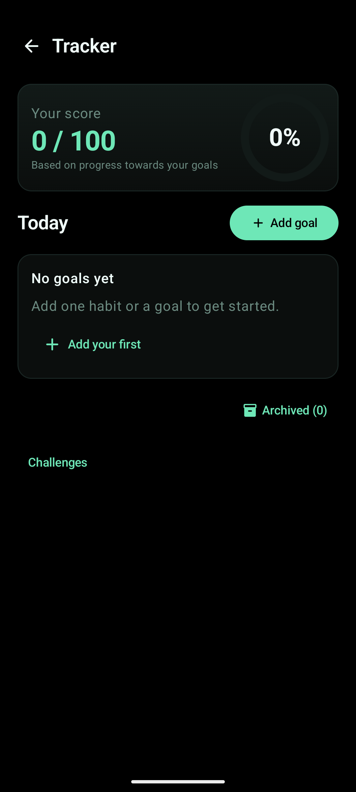
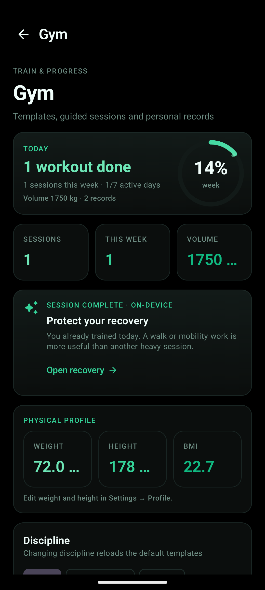
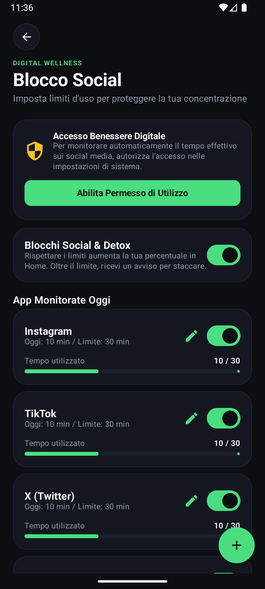
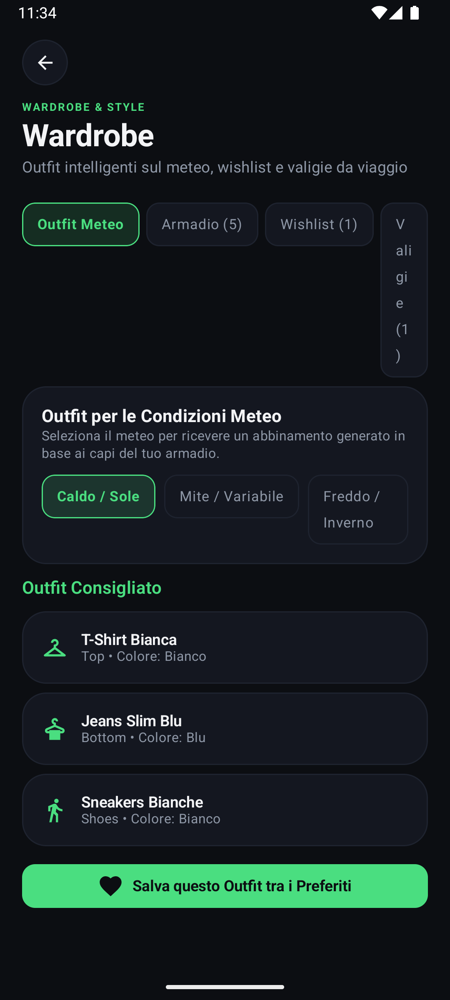
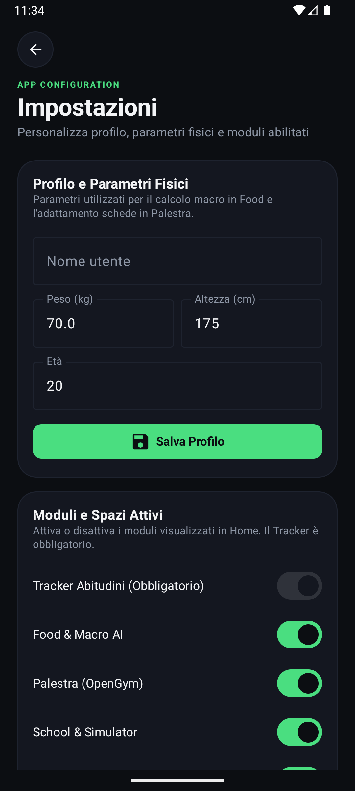

# 🚀 Progress 1% — Crescita Personale & Benessere a 360°

<p align="center">
  <b>Migliora dell'1% ogni giorno. Tutto offline, sicuro e privato.</b>
</p>

---

## 📱 Visione & Concetto
**Progress 1%** è un'app Android progettata attorno al principio del miglioramento continuo quotidiano (*Kaizen*). Tutto ruota attorno alla **Percentuale in Home**: uno score unificato (0–100%) che sintetizza in tempo reale la costanza e il progresso nelle varie dimensioni della vita personale.

Tutti i dati vengono salvati **100% offline in locale (file JSON)** sul dispositivo: nessun dato personale o abitudine viene condiviso su server esterni.

---

## ✨ Funzionalità & Moduli

### 1. 🎯 Tracker Abitudini (Core Obbligatorio)
- Creazione goal di tipo **COUNT** (es. bere 2L d'acqua, fare 10.000 passi) o **QUIT** (es. smettere di fumare, eliminare zuccheri).
- Periodicità configurabile: **Settimana**, **Mese**, **Anno**.
- **Score dedicato e indipendente**: monitora la consistenza specifica delle tue abitudini.

### 2. 🥗 Food & Macro AI (Riconoscimento Immagine + Gemini)
- Riconoscimento fotografico alimenti con modello di computer vision integrato (101 classi alimentari).
- Calcolo automatico e stima dei macronutrienti (Calorie, Proteine, Carboidrati, Grassi) e porzioni tramite AI (Google Generative AI con fallback nutrizionale offline).
- Monitoraggio pasti giornalieri (Colazione, Pranzo, Cena, Snack) e target calorico.
- **Influenza la percentuale in Home**.

### 3. 🏋️‍♂️ Palestra (OpenGym Nativo)
- Integrazione nativa e semplificata delle funzionalità chiave di OpenGym.
- Dati fisici unificati col profilo utente (Peso, Altezza, BMI calcolato).
- Schede di allenamento personalizzabili (Upper Body, Lower Body, Push/Pull/Legs).
- Sessione di allenamento interattiva con **Rest Timer** (conto alla rovescia di recupero tra serie), carichi e ripetizioni.
- Registro dei massimali e record personali (**PR**) e storico allenamenti.
- **Influenza la percentuale in Home**.

### 4. 📚 School & Simulator
- Monitoraggio voti e calcolo della media generale e per singola materia.
- Calendario delle prossime verifiche e interrogazioni.
- **Simulatore di Voti**: inserisci un ipotetico voto per vedere istantaneamente l'impatto sulla media della materia e sulla media generale complessiva.
- **Influenza la percentuale in Home**.

### 5. 💰 Money & Budget
- Tracciamento entrate e uscite suddivise per categoria (Cibo, Trasporti, Shopping, ecc.).
- Pianificazione e controllo del budget mensile con progress bar visiva.
- Monitoraggio spese giornaliere e mensili.
- **Influenza la percentuale in Home**.

### 6. 📝 Tasks & Promemoria
- Gestione attività quotidiane con scadenza oraria.
- Notifiche locali di promemoria tramite Android WorkManager.
- Completare più compiti fa salire direttamente il punteggio giornaliero.
- **Influenza la percentuale in Home**.

### 7. 🏆 Challenges Offline
- Sfide preimpostate a medio e lungo termine (7, 14, 21, 30 giorni) per creare abitudini virtuose (es. sveglia alle 6:00, no junk food, gratitudine quotidiana).
- Creazione di sfide personalizzate.
- Check-in giornaliero e tracciamento progresso giorni.
- **Influenza la percentuale in Home**.

### 8. 📵 Digital Detox & Blocco Social Media
- Integrazione con l'API *UsageStats* (Benessere Digitale di Android).
- Impostazione limiti di tempo giornalieri per le app social (Instagram, TikTok, X, Facebook, ecc.).
- Rispettare i limiti social fa crescere la percentuale in Home; in caso di superamento viene mostrato un avviso chiaro.
- **Influenza la percentuale in Home**.

### 9. 👔 Wardrobe & Outfit Check
- Gestione guardaroba digitale per categorie (Top, Bottom, Scarpe, Capispalla) e stagioni.
- **Outfit Meteo**: genera automaticamente combinazioni ottimali in base alle condizioni meteorologiche (Sole/Caldo, Pioggia, Freddo).
- Wishlist capi desiderati con prezzo.
- Liste valigia con checklist per i viaggi.
- *(Questo modulo non influisce sulla percentuale in Home)*.

---

## 📸 Galleria Screenshot (Design Minimal Dark & Mint)

Tutte le schermate seguono un design minimale scuro (`#0D0F14`) con bordi soffusi (`#1E232F`), accenti verde menta (`#4ADE80`), font puliti e barra di navigazione a dock fluttuante:

| Home & Dock | Tracker Abitudini | Food & Macro AI |
|:---:|:---:|:---:|
|  |  |  |

| Palestra (OpenGym) | Scuola & Simulatore | Finanze & Budget |
|:---:|:---:|:---:|
|  |  |  |

| Tasks & Promemoria | Challenges Offline |
|:---:|:---:|
|  |  |

| Blocco Social Media | Wardrobe & Meteo | Impostazioni & Profilo |
|:---:|:---:|:---:|
|  |  |  |

---

## 🔒 Sicurezza & Privacy
- **Nessuna API Key committata**: le chiavi per i servizi esterni (Gemini AI) sono gestite tramite `local.properties` e protette nel file `BuildConfig`.
- **Dati 100% Offline**: salvataggio in locale su file JSON nella memoria protetta dell'applicazione (`context.filesDir`).
- **Nessun tracking**: nessuna libreria di analitica di terze parti o telemetria invasiva.
- **File sensibili esclusi dal repository**: `.gitignore` protegge file di build, keystore, file di proprietà e artefatti di debug.

---

## 🛠️ Stack Tecnologico
- **Linguaggio**: Kotlin 2.2.10
- **UI Toolkit**: Jetpack Compose (BOM 2026.02.01) + Material Design 3
- **Architettura**: MVVM (Model-View-ViewModel) + Repository Pattern + StateFlow
- **Persistenza**: Kotlinx Serialization JSON offline
- **Background Tasks**: WorkManager
- **Compatibilità**: Android 7.0+ (minSdk 24, targetSdk 37)

---

## 📦 Installazione APK

L'APK compilato e pronto all'uso è disponibile nella root del repository o nell'archivio di release:
- `Progress1Percent_v1.0.apk`

Per installarlo tramite `adb`:
```bash
adb install -r Progress1Percent_v1.0.apk
```

---

## 💻 Compilazione da Sorgente

1. Clona il repository:
```bash
git clone https://github.com/tuo-username/Progress1Percent.git
cd Progress1Percent
```

2. (Opzionale) Aggiungi la tua Gemini API Key in `local.properties`:
```properties
sdk.dir=/path/to/your/Android/Sdk
GEMINI_API_KEY=la_tua_api_key_qui
```

3. Compila l'APK:
```bash
./gradlew assembleDebug
```

---

## 📄 Licenza
Rilasciato sotto licenza MIT.
